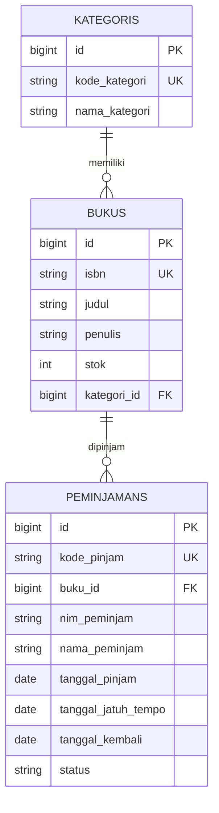

# SIPUS-Del: Sistem Informasi Perpustakaan Kampus Del

Tugas Mandiri Praktikum Minggu 5 (12S3101 Pemrograman & Pengujian Web)
Institut Teknologi Del. Dibuat oleh: **Enjel Ayuti Napitupulu 12S24056**

Aplikasi manajemen buku dan kategori perpustakaan berbasis **Laravel 11** dengan arsitektur MVC.

## Fitur
- CRUD Buku dan Kategori (`Route::resource`, 7 aksi RESTful, Implicit Route Model Binding)
- Relasi Eloquent: `Kategori hasMany Buku`, `Buku belongsTo Kategori`
- Proteksi mass assignment (`$fillable`)
- Eager Loading (`Buku::with('kategori')`) untuk mencegah N+1 query
- Validasi server-side (`$request->validate()`), proteksi CSRF (`@csrf`, `@method`)
- Blade Component layout `<x-layout>` bertema Del Purple (#4C1D95)
- Pagination Bootstrap 5, flash message, `@forelse` untuk data kosong
- Factory dan Seeder (5 kategori, 20 buku) dengan Faker
- Audit kueri SQL via `DB::listen`

## Skema Database
| Tabel | Kolom |
|---|---|
| `kategoris` | id, kode_kategori (unique), nama_kategori, timestamps |
| `bukus` | id, isbn (unique), judul (index), penulis, penerbit, tahun_terbit, kategori_id (FK), stok, sinopsis, timestamps |

## Aturan Validasi Buku
- ISBN: wajib, 13 digit, unik
- Judul: wajib, minimal 5 karakter
- Tahun terbit: 1900 sampai tahun berjalan
- Stok: integer, minimal 0
- Kategori: harus ada di tabel `kategoris`

## Instalasi
Prasyarat: PHP 8.2+ (ekstensi `pdo_sqlite`, `sqlite3`, `mbstring`, `openssl`, `fileinfo`), Composer.

```bash
git clone https://github.com/[username]/ppw-2026-week5-[NIM].git
cd ppw-2026-week5-[NIM]
composer install
cp .env.example .env        # Windows CMD: copy .env.example .env
php artisan key:generate
php artisan migrate:fresh --seed
php artisan serve
```
Buka http://localhost:8000

Catatan: jika `database/database.sqlite` belum ada, buat file kosong dengan nama itu.

## Bukti Audit SQL (Eager Loading)
Listener `DB::listen` di `AppServiceProvider` mencatat semua kueri ke `storage/logs/laravel.log`.

Halaman `/buku` menjalankan **3 kueri tetap**:
1. `select count(*) ... from "bukus"` (dari `paginate()`)
2. `select * from "bukus" ... limit 10 offset 0`
3. `select * from "kategoris" where "id" in (...)` (eager loading)

Modul menyebut 2 kueri, namun `paginate()` selalu menambah 1 kueri `count` untuk menghitung total halaman. Yang terpenting, jumlah kueri tidak bertambah seiring banyaknya baris. Tanpa `with()`, kueri kategori akan berulang satu kali per buku (N+1).

Bukti lengkap: [docs/sql-audit.md](docs/sql-audit.md) dan `docs/sql-audit.png`.

## Struktur Utama
```
app/Models/            Buku, Kategori
app/Http/Controllers/  BukuController, KategoriController
database/migrations/   skema kategoris, bukus
database/factories/    BukuFactory, KategoriFactory
database/seeders/      DatabaseSeeder
resources/views/       components/layout, buku/*, kategori/*
```

---

# Minggu 6: SIPUS-Del Tahap 2 (Transaksi ACID, Query Builder, Session & Auth)

Branch: `week6-db-session`

## Akun Uji Pustakawan
| Email | Password |
|---|---|
| pustakawan@del.ac.id | password123 |

## Instalasi
```bash
git clone https://github.com/USERNAME/ppw-2026-week5-NIM.git
cd ppw-2026-week5-NIM
git checkout week6-db-session
composer install
cp .env.example .env        # Windows CMD: copy .env.example .env
php artisan key:generate
php artisan migrate:fresh --seed
php artisan serve
```

## ERD


## Fitur
- Tabel `peminjamans` dengan FK `buku_id` (`cascadeOnDelete`), relasi `Buku hasMany Peminjaman`
- Peminjaman dan pengembalian dalam `DB::transaction()` + `lockForUpdate()`; stok 0 dan NIM ganda ditolak (rollback); `QueryException` dicatat via `Log::error()`
- Katalog: `with('kategori')->withCount('peminjamans')`, filter `when()`, `withQueryString()`
- Statistik dengan `DB::table()`: total judul, total stok, sedang dipinjam, dikembalikan
- Login/logout dengan `Auth::attempt()`, `session()->regenerate()`, `invalidate()` + `regenerateToken()`
- Middleware `auth` pada semua rute mutasi; state session (`login_timestamp`, `last_search`); cookie `del_last_user_email` via `Cookie::queue()`

## Bukti Pengujian
| Pengujian | Bukti |
|---|---|
| Pinjam berhasil |  |
| Stok 0 ditolak (rollback) |  |
| Pengembalian |  |
| Cookie HttpOnly (DevTools) |  |
| Login |  |
| Koneksi DB |  |
| Audit SQL katalog |  |

## Catatan SQLite
SQLite tidak punya row-level locking, jadi `lockForUpdate()` tidak menghasilkan `SELECT ... FOR UPDATE` seperti MySQL InnoDB. SQLite mengunci seluruh file saat menulis, sehingga stok tetap tidak bisa minus. Kode langsung bekerja penuh jika dipindah ke MySQL.